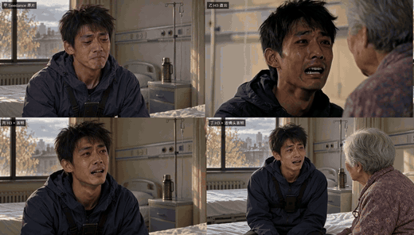
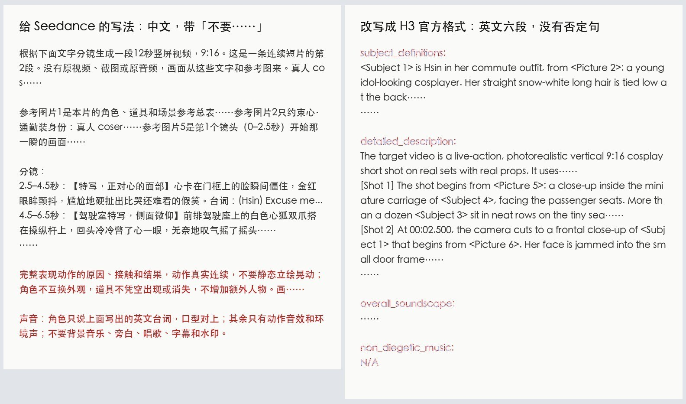

# h3-ref-video：H3 参考图出片

像给 Seedance 写提示词、给参考图那样，在 RunningHub 上用 MiniMax H3 出视频：你照常写中文分镜和「参考图片1、参考图片2…」，工具把它改写成 MiniMax 官方的六段式格式再提交；一份分镜脚本还能整条出片，每个镜头先用 GPT Image 2.5 画一张分镜图垫给 H3，人物、道具、比例照图来。

为什么折腾这个：H3 在 RunningHub 上按机器时间收费，标准机型每输出一秒大约 ¥0.009，Seedance 2.0 mini 480p 是 ¥0.102，差了十倍多。一条 27 秒、11 个镜头的竖屏短片，用这个仓库的 `film` 命令跑：11 张 1K 分镜图 ¥1.85，H3 两段并行生成 ¥0.27，一共 ¥2.12，从开始到出片 9 分钟；同长度 Seedance mini 约 ¥2.8。

```bash
# 一条片段：提示词和参考图跟给 Seedance 的一样
python h3ref.py one --prompt 提示词.txt --image 角色.jpg --image 场景.jpg --seconds 12 --aspect 9:16 --out jobs/试一条

# 整条片：分镜脚本 → 切段、每镜分镜图、改写、生成、查烧字幕、拼片
python h3ref.py film jobs/快递 --film examples/film.example.json
```

## 效果

**同一个脚本、同一对演员**：左边 Seedance 2.0 mini（一条 ¥1.53），右边 H3 每个镜头先垫一张分镜图（7 张图 ¥1.06 + 生成 ¥0.15，一共约 ¥1.2）。画面质感基本打平，H3 的舞台灯光更足，Seedance 哭得更夸张。点图看原视频（有声）。

[](docs/media/qiangjinmai-seedance-vs-h3.mp4)

H3 这条用的 7 张分镜图，第一张画好以后，后面每张都带着它当参考，人和场景才前后一致：


**同一个镜头，左边 H3 直出，右边先画一张分镜图再出**：

[](docs/media/plain-vs-storyboard.mp4)

**中文真人哭戏，四个版本盲评**（静音）：左上 Seedance，右上 H3 直出（输），左下 H3 垫一张首帧（4:0 赢 Seedance），右下 H3 每个镜头垫分镜图：

[](docs/media/hospital-four-versions.mp4)

**同一段提示词**：左边是给 Seedance 的写法，红字就是会把背景音乐和字幕招进来的「不要……」；右边是改写后的 H3 官方六段式：



## 准备

1. **Python 3.10+、ffmpeg**，`pip install -r requirements.txt`。
2. **两个 key**，复制 `.env.example` 成 `.env` 填上：
   - `RUNNINGHUB_API_KEY`：[RunningHub](https://www.runninghub.cn) 控制台「API 调用」。会员 key 一次跑 5 个、扣 RH 币；企业 key 扣钱包，能同时跑很多个。
   - `APIMART_API_KEY`：[APIMart](https://apimart.ai)，画分镜图（GPT Image 2.5）和查烧字幕（Gemini 3.8 Flash）。
3. **改写提示词的模型**：装了 [Claude Code](https://claude.com/claude-code) 并登录过，默认就用它（我们一直用的是这个）；没装就走 APIMart 上的模型（`H3_REWRITER=llm`，默认 `deepseek-v4-pro`，也可以换成任何 OpenAI 兼容接口）。DeepSeek 改写我们试过，格式检查能过；上 H3 出片对比过的只有 Claude 改写的版本。
4. **MiniMax 官方提示词指南**：工具运行时从 [MiniMax-AI/MiniMax-H3](https://github.com/MiniMax-AI/MiniMax-H3/tree/main/skills/h3-prompt-writing) 现取 `ref-en.txt` 并缓存，没有随仓库分发（它属于 MiniMax H3 Community License 下的文档）。网络不通就自己下载，用 `H3_GUIDE_FILE` 指过去。

用 Claude Code 或 Codex 的话，把仓库放进 skills 目录（比如 `~/.claude/skills/h3-ref-video`），直接说「用 H3 把这个分镜做成片」，它会照 `SKILL.md` 写 film.json、跑、看报告。

## 一条片段：`one`

提示词就按 Seedance 的写法：画面描述、分镜时间、台词、「参考图片N 是谁」。工具先改写成官方格式（结果存在 `--out` 目录的 `prompt.h3.txt`），再连同参考图提交，大约 4–6 分钟出一条 544×960（竖屏）或 960×544（横屏）的片子，带模型自己生成的声音。已经是六段式的提示词原样提交。台词里有中文、日文、韩文时，生成后会自动查一次有没有烧字幕。

## 整条片：`film`

分镜脚本写成 JSON，格式看 `examples/film.example.json`：画幅、画风一句话、场景与道具、台词语言、角色（名字、参考图、外观描述）、每个镜头的起止秒数、机位、动作和台词。

工具按镜头边界切成每段不超过 15 秒，然后：

1. **画分镜图**（`--frames shot`，默认）：每个镜头画一张「这个镜头刚开始那一瞬」的图。全片第一张先画，后面每张都把它当参考，演员和场景就前后一致。参考图按像素收费，上传前缩到 1024 像素。
2. **写提示词**：每段按 Seedance 的写法拼出中文提示词（参考图片1 是总表、2 是谁、之后每张是第几个镜头的首帧），再改写成 H3 官方格式。
3. **生成**：每段参考图最多 9 张（工作流就 9 个图片口），放不下时先拿掉总表，再拿掉后面镜头的分镜图。分镜图模式下各段互不依赖，一起提交。
4. **查烧字幕、拼片**，出 `film.mp4` 和 `report.md`（每段费用、GPU 时间、字幕检查结果）。

断了就原样再跑 `film jobs/<任务名>`：每张图、每个 RunningHub 任务提交后先记下任务号再等结果，续跑只接着查，不重复花钱。某段不满意，`--redo 2` 给第 2 段换种子重跑。

三种分镜图模式：

| 模式 | 做法 | 什么时候用 |
|---|---|---|
| `shot` | 每个镜头一张分镜图 | 默认。人多、镜头多，站位和道具要照剧本来的戏 |
| `first` | 每段只给第一个镜头一张，后一段再接前一段的最后一帧 | 想省图钱、对白戏 |
| `none` | 不画图，只给角色图，各段接着上一段的最后一帧 | 动漫、cos 这类 H3 直出就够好的线 |

## 我们测出来的结论

都是同一份脚本、同样的参考图和时长，对着 Seedance 2.0 mini 盲评出来的：

- **动漫和 coser 片，H3 直出已经赢 Seedance**，成本约十分之一。两个镜头各 4 轮盲评，H3 4:0、4:0。
- **中文真人对白戏，H3 直出会输**（0:4）；垫一张首帧以后哭戏能赢（4:0），带货戏还是输。
- **每镜分镜图能让 H3 稳稳追上 Seedance**：同一个脚本做了 15 条真人 cos 短片，8 条用 Seedance、7 条用 H3 每镜分镜图。同一对演员的两条放在一起，画面质感基本打平，H3 舞台灯光更足，Seedance 哭得更夸张；钱上 Seedance 一条 ¥1.53，H3 加 7 张分镜图约 ¥1.2。分镜图最管用的是让 H3 照着剧本演：人站在哪、镜头从哪起、谁先开口。
- **官方格式是关键**：Seedance 写法的提示词直接给 H3，7 段里 7 段被垫了背景音乐，中文对白会烧字幕，表演也收着。工作流没有负面提示词，「不要背景音乐、不要字幕」反而会把音乐和字幕招进来。改成官方六段式、去掉所有否定句、配乐写 N/A 之后，13 段里只剩 1 段有音乐，和 Seedance 逐段盲评 H3 赢 5、Seedance 赢 1、平 5。

还要注意的：

- **中文对白会烧字幕**，一次把「三千八」写成了 3000，所以有台词的段落一定要查（工具会自动查，报告里标出来）。
- 垫了分镜图的镜头，开头一两秒会比较静，像从照片里动起来。
- 大的情绪反应（惊吓、疼）H3 还是演得偏小，提示词里要写具体的脸和身体动作。
- 高配（Ultra 机型、736×1312、30 步）大约慢 8 倍、贵 17 倍，只换来更锐的细节，不值得开。超分到 720p 每 15 秒多 ¥0.32，手机上看提升一般。
- 会员 key 同时只能跑 5 个；偶尔会爆显存失败，失败不扣费，再跑一次就好。

## 文件

- `h3ref.py` 命令入口；`h3ref/film.py` 分镜脚本、切段、参考图顺序、中文提示词和整条流程；`rewrite.py` 改写成官方格式和格式检查；`frames.py` 分镜图；`rh.py` RunningHub；`check.py` 烧字幕检查；`media.py` ffmpeg。
- `prompts/h3_examples.md`：两条手工改写、在 H3 上测过的样例（中文 Seedance 写法 → 官方六段式），改写时一起给模型看。
- `workflows/h3-ref2va-turbo.json`：RunningHub 用户 user_3ww6n2yr 的公开工作流[「加速版-MiniMax H3｜多参图像音频极速生视频」](https://www.runninghub.cn/post/2113525277564424193)，归原作者，说明见 `workflows/README.md`。

## 许可

代码和 `prompts/` 是 MIT。`workflows/` 里的节点图归原作者；MiniMax 官方提示词指南和 H3 模型遵守 [MiniMax H3 Community License](https://huggingface.co/MiniMaxAI/MiniMax-H3/blob/main/LICENSE)。

想做「照着原片换人」的翻拍（MV、舞蹈），看姊妹仓库 [mv-swap](https://github.com/garycaogan/mv-swap)。
